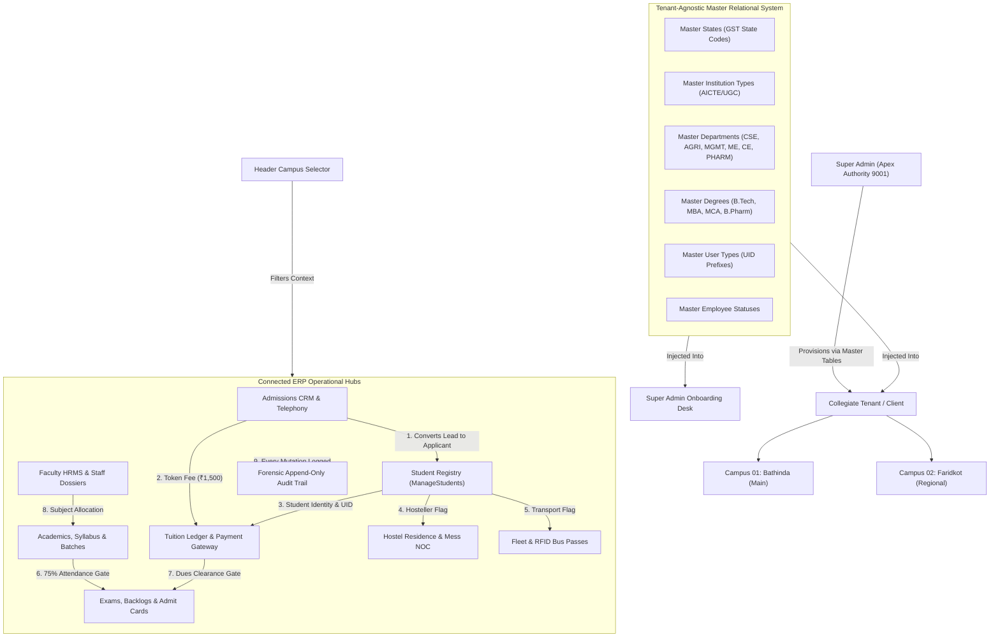
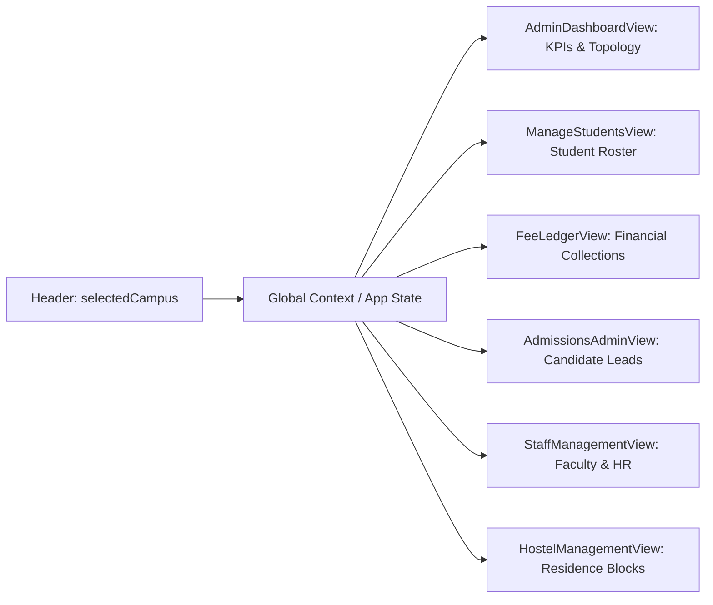
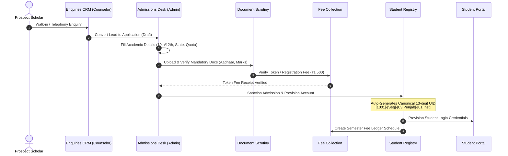
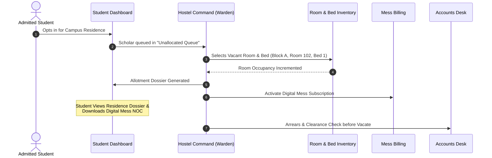
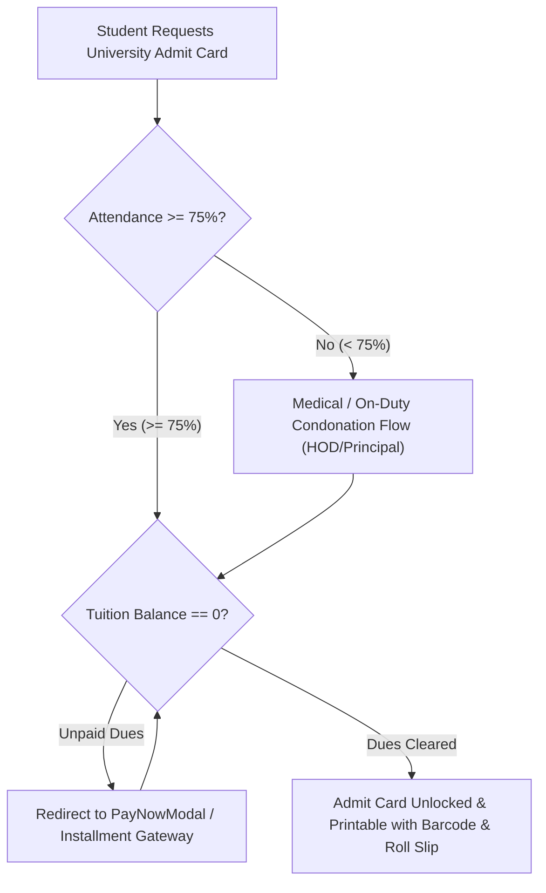

# EduCore Enterprise ERP — End-to-End System Architecture & Connection Map

> Single Source of Truth for Relational Integrity, Cross-Module Data Flow, Campus Filtering, and Master Table Bindings.

---

## 1. Executive Topology & Architecture Overview

EduCore ERP operates as a multi-campus, multi-tenant collegiate operating platform. System execution enforces dynamic, database-driven configurations rather than hardcoded client options (as mandated by Karanvir Sir in Recordings 160, 161, and Lecture 3/4).

---

## 2. Master Tables Relational Binding Matrix

Hardcoded dropdowns and fixed string arrays are completely prohibited. Master tables dictate all categories, dropdown choices, and validation constraints.

| Master Table | Key Columns | Bound Front-End Modules & Components | Functional Behavior |
| :--- | :--- | :--- | :--- |
| `master_states` | `gst_code`, `state_name`, `state_short_code`, `is_ut` | `SuperAdminDashboardView` (Onboarding), `AdmissionsAdminView`, `StudentProfileModal` | Defines GST state code for canonical UID (`[Type]-[Seq]-[State]-[Inst]`). Prevents invalid state entries. |
| `master_institution_types` | `code`, `name`, `regulatory_authority`, `description` | `SuperAdminDashboardView`, `AdminDashboardView` | Defines statutory authority (AICTE, UGC, PCI, BCI) for new institutions and accreditation limits. |
| `master_departments` | `dept_code`, `dept_name`, `tags`, `head_of_dept`, `established_year` | `AcademicsView`, `StaffManagementView`, `SuperAdminDashboardView`, `ManageStudentsView` | Dynamically populates department filters, subject offerings, faculty allocation, and batch creation. |
| `master_degrees` | `degree_code`, `degree_name`, `level`, `duration_years`, `total_semesters` | `AcademicsView`, `AdmissionsAdminView`, `UniversityExamPortalView`, `ManageStudentsView` | Determines standard semester count (8 for B.Tech, 4 for MBA), grade cards, and degree certificates. |
| `master_user_types` | `type_code`, `alpha_prefix`, `role_key`, `display_title` | `UserManagementView`, `SuperAdminDashboardView`, `Header.tsx` | Enforces canonical UID structure (e.g., `4001` for Admin, `1001` for Student, `2001` for Faculty). |
| `master_employee_statuses` | `status_code`, `status_name`, `description`, `requires_dates` | `StaffManagementView`, `UserManagementView` | Governs formal HR status transitions (Active, Resigned, Terminated, AWOL) with mandatory exit dates. |
| `master_document_types` | `doc_type_code`, `title`, `mandatory_for`, `max_file_size_mb` | `StudentDocumentsView`, `AdmissionFormView` | Dictates mandatory document verification checklist before admission sanction. |
| `master_hostel` | `block_code`, `ownership`, `washroom_typology`, `safety_timer_days`, `mess_policy` | `HostelManagementView`, `MasterTablesModal` | Governs residence blocks, ARW (Attached) vs FCW (Floor Common) washrooms, 360-day overhaul, 90-day electrical inspection, and mess billing policies. |
| `master_fees` | `head_code`, `head_name`, `statutory_category`, `is_refundable`, `concession_tiers` | `FeeLedgerView`, `MasterTablesModal` | Itemized tuition, caution deposit, exam, hostel, and mess fee heads; merit and sibling waiver tiers; contra-ledger demotion adjustments. |

### 2.1 Direct Master Table Access in Operational Views
Per mentor Karanvir Sir's architectural directive (*"Har setting ke andar ek button hoga master table / master data"*):
- **Super Admin Dashboard** (`SuperAdminDashboardView.tsx`): Dedicated "Master Tables & Architecture" button in top command strip (`onOpenMasterTables('institutions')`). Client onboarding modal includes inline "+ Master" drawers.
- **Admin Operations Dashboard** (`AdminDashboardView.tsx`): Prominent "Master Data" button in quick filter toolbar (`onOpenMasterTables()`).
- **Hostel Operations** (`HostelManagementView.tsx`): "Master Residence Data" button in header toolbar, "Master Residence Settings" in Tab 2, and "Master Typologies" in Tab 3 (`onOpenMasterTables('hostel')`), plus "+ Add Residence Block" interactive modal.
- **Tuition & Fee Ledgers** (`FeeLedgerView.tsx`): "Master Fee Heads & Rules" button in collections action bar (`onOpenMasterTables('fees')`).
- **Student Registry** (`ManageStudentsView.tsx`): "+ Master Degrees & Ordinances" button in horizontal filter strip (`onOpenMasterTables('degrees')`).
- **Faculty & HRMS** (`StaffManagementView.tsx`): "Master Employee Statuses" button in top toolbar (`onOpenMasterTables('employee')`).
- **Academic Topology & Curriculum** (`AcademicsView.tsx`): "Master Degrees & Ordinances" button in curriculum header (`onOpenMasterTables('degrees')`).

---

## 3. Campus Context & Multi-Campus Filtering Architecture

The Header Campus Selector (`selectedCampus`) controls the operational lens across all ERP views.

### Filtering Behavior by Option:
1. **`campus_01` (Bathinda Main Campus)**:
   - Displays students enrolled in Bathinda campus (`campus_id === 'campus_01'`).
   - Fee ledger totals represent Bathinda collections only.
   - Admissions radar shows Bathinda walk-ins and applications.
   - Hostel shows SBS Block A, B, and C located in Bathinda.
   - Faculty roster filtered to Bathinda teaching assignments.
2. **`campus_02` (Faridkot Regional Campus)**:
   - Displays students enrolled in Faridkot campus (`campus_id === 'campus_02'`).
   - Fee ledger totals represent Faridkot collections only.
   - Admissions radar shows Faridkot regional leads.
   - Hostel shows Faridkot Regional Residence Block.
   - Faculty roster filtered to Faridkot teaching assignments.
3. **`all` (All Campuses / Consolidated)**:
   - Aggregates metrics and totals across all campuses.
   - Tables display campus badge on each record (e.g. `[Bathinda]` or `[Faridkot]`).

---

## 4. End-to-End Cross-Module Workflow Pipelines

### Pipeline A: Admissions CRM to Enrolled Scholar Lifecycle

### Pipeline B: Residence & Transit Logistics

### Pipeline C: Examination Eligibility Dual-Clearance Gate

### Pipeline D: Student Demotion & Academic Reset Ordinances
Per Karanvir Sir Lecture Recording 160 mandate:
- When a student is demoted (e.g. from Sem 4 back to Sem 3 due to year-back or major backlogs):
  - **Option 1 (Non-Destructive Academic Journey)**: Preserve historical semester attendance, marks, and ledger transactions in software journey.
  - **Option 2 (Clean Reset)**: Reset active academic standing and courses from the demoted semester onwards while locking prior fee payments.

---

## 5. Audit Logging & Forensic Traceability Matrix
Every mutating action writes an append-only cryptographic event:
- **Actor Identity**: Full Name, Enterprise UID, Institutional Role.
- **Client Fingerprint**: IPv4/IPv6, Platform OS, Hardware Fingerprint.
- **Target Entity**: Entity Type (`student`, `fee_payment`, `user`, `admission`, `hostel_bed`), Entity ID.
- **Payload Diff**: JSON diff containing prior value and updated value.
- **Severity**: `info`, `warning`, `critical` (apex role promotion or fee waiver).

---

## 6. Verified Production Wiring & System State

| Component / Subsystem | Connected Data Source | Verified Functional Behavior |
| :--- | :--- | :--- |
| **Global Campus Context** (`CampusContext.tsx`) | SQLite / MariaDB `campuses` table | Persists active campus (`campus_01`, `campus_02`, `all`) in `localStorage` across page reloads and deep routes. |
| **Top Navigation Ribbon & Header** (`Header.tsx`) | `useCampus()` & `master_campuses` | Unclipped, sleek, minimalist Apple-style dropdown directly switches operational view. Verified zero "EduCore OS" text leaks. |
| **Super Admin Onboarding** (`SuperAdminDashboardView.tsx`) | `master_states`, `master_institution_types`, `master_departments` | Dropdowns dynamically populated from live DB master tables. Includes direct "+ Master" shortcut drawers. |
| **Master Architecture Drawer** (`MasterTablesModal.tsx`) | `api/master/*` endpoints | Live count badges and inline drawers for adding States, Degrees, Departments, and Institution Types into SQLite. |
| **Student Registry** (`ManageStudentsView.tsx`) | `students.campus_id` | Scopes pagination and queries by `campus_01` (Bathinda Main: 52) vs `campus_02` (Faridkot: 15). |
| **Fee Ledger & Defaulters** (`FeeLedgerView.tsx`) | `api/fees/defaulters?campus=` | Scopes fee collections and defaulters to selected campus (Bathinda: 15 defaulters, Faridkot: 2 defaulters). |
| **Admissions & Prospects** (`AdmissionsAdminView.tsx`) | `api/admissions?campus=` | Followup radar and candidate intake filter by campus. |
| **Hostel Residence Command** (`HostelManagementView.tsx`) | `buildings` & `rooms` scoped by `campus_id` | Displays Bathinda Blocks (SBS-A, MG-B, BDS-C) vs Faridkot Block (FDK-A). Room inventory and occupancy metrics filter synchronously. |
| **Transport Fleet** (`TransportManagementView.tsx`) | `vehicles` & `routes` scoped by `campus_id` | Scopes collegiate transit lines by campus region. |
| **Automated Verification Suite** | `test_campus_master_integration.mjs` & `test_live_ui_audit.mjs` | 100% pass rate across 104 assertions in live headless browser testing. |

