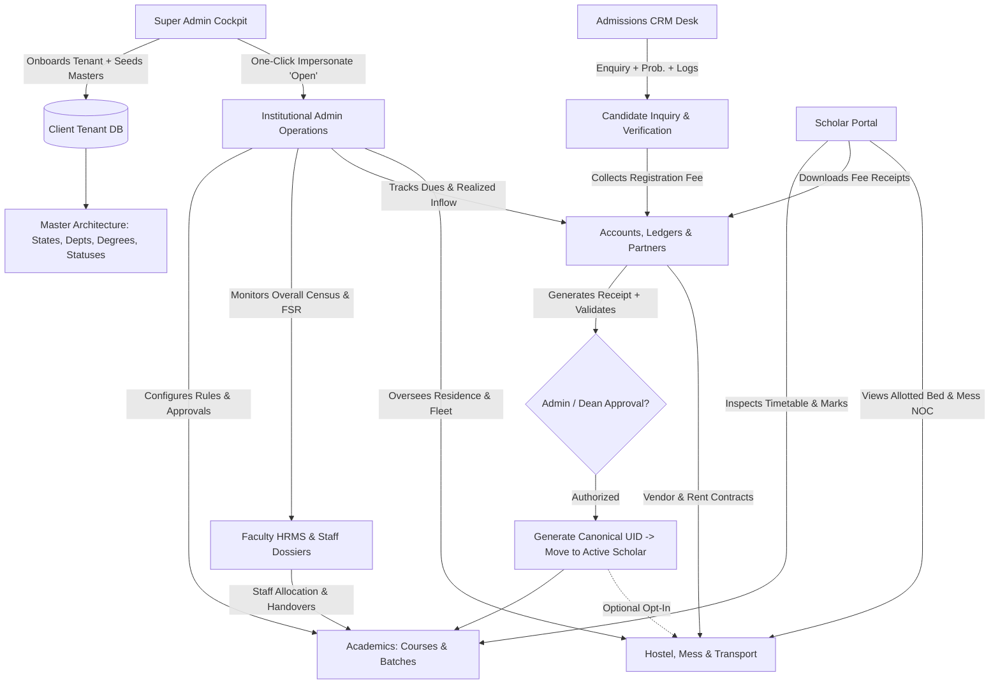

# EduCore ERP • Complete Master Architecture & End-to-End System Blueprint
**Single Source of Truth based on Mentor Karanvir Sir Lectures & Forensic Recordings**

---

## 1. Architectural Philosophy & Core Axioms
1. **Zero Popups / Zero Modal Overlays**:
   All workflows (onboarding, master tables, admissions, transfers, batch promotion, hostel allotment, fee collection) operate as inline canvas cards, expandable viewports, or segmented master tabs directly embedded on the page canvas.
2. **Canonical Pure-Digit Identifiers (Karanvir Sir Seg 000 & Lecture 4)**:
   - **Student UID (10-13 digits)**: `[Type4]-[Seq2]-[Client2]-[State03]-[Inst01]`
     - E.g. `1001-88-03-01` (Aryan Sharma, CSE, Punjab Campus 01)
   - **Employee ID (8-9 digits)**: `[RoleType4]-[EmpSeq2]-[State03]-[Inst01]`
     - E.g. `2001-14-03-01` (Teaching Faculty), `4001-01-03-01` (Institutional Principal), `9001-01-03-01` (Universal Provost / Super Admin)
3. **Master Table Governance (Seg 006 & Recording 160)**:
   Every categorical entity (GST States, Departments, Degrees, Batches, Designations, Employee Statuses, Student Admission Statuses, Maintenance Check Types) lives in dynamic database Master Tables. Zero hardcoded lists.
   Master records referenced in active transactions cannot be hard-deleted (Safety Gate).
4. **Financial Invariance & Contra Ledger (Seg 005 & Recording 161)**:
   Zero deletion policy for financial ledgers. Every modification, discount, demotion adjustment, or reversal generates an immutable balancing contra-entry.

---

## 2. End-to-End Connection & Role Interaction Map

---

## 3. Role-by-Role Functional Specifications

### A. Super Admin (Universal Provost & Multi-Tenant Cockpit)
- **Tenants & Colleges Directory**:
  - Live list of client institutions with Client ID, Subdomain (`*.gurudotcom.erp`), Schema Name, Status (`Active` / `Inactive`).
  - **"Open" Button**: One-click direct impersonation without password into the client college admin console. Stores `educore_jwt_token` and `educore_user_data` cleanly.
  - **Active Toggle**: Instantly activate or suspend tenant access.
  - **Reset Admin Password**: Inline password reset with OTP simulation.
- **Inline College Onboarding**:
  - Section 1: Institutional Identity (Full name, short code, entity category, city, subdomain).
  - Section 2: Administrative Credentials (Principal/Registrar name, phone, official email, initial password).
  - Section 3: **Direct Master Tables Configuration** (GST State code selection with inline state creation, Departments selection, Degrees selection). Automatically seeds master tables into new tenant database schema.
- **Cluster Telemetry & Logs**:
  - Database pool status (PostgreSQL / SQLite).
  - Cryptographic audit trail with forensic event log viewer.

### B. Header & Global Navigation
- **Campus Selector**:
  - Super Admin: Displays "Universal Platform Management" with tenant selector dropdown.
  - College Admin / Staff: Multi-campus context switcher:
    - `Campus 01 - Bathinda (Main)`
    - `Campus 02 - Faridkot (Regional)`
    - `All Campuses (Consolidated)`
  - Bound globally to filter all academic, student, staff, fee, and hostel data.
  - Students: Displays fixed assigned campus badge (no switching).
- **Academic Term Selector**: Prominent display with current session (`2025-2026 Odd Sem`) and previous terms.
- **Canonical UID Pill**: Quick 1-click copy with toast alert.
- **User Profile Dropdown**: Photo, Name, Role badge, Password Reset, and Logout.

### C. College Admin (Operations Console)
- **4 Core Executive Metric Cards**:
  1. *Total Staff*: Breakdown: `[Admin] + [Teaching] + [Non-Teaching] = Total Staff`.
  2. *Active Scholars*: Total active students with seat fill rate and capacity. Clicking opens inline department topology drilldown table with percentages and totals at the top.
  3. *Faculty-Student Ratio (FSR)*: AICTE/UGC compliance ratio (`1:18.4`).
  4. *Revenue Forecast*: Projected pending fee dues for the semester.
- **Executive Governance & Actions**:
  - Student progression approval reviews.
  - Staff exit NOC and clearance sanctioning.
  - Combined class timetable audit.
  - 75% attendance detained warning list.
- **Live Support Tickets Queue**:
  - Direct intake of tickets generated from Login Page 3D Flip Card ("Contact Admin").
  - Ticket ID, submitter UID, topic, concern, and status toggle (`Open`, `In Progress`, `Resolved`).

### D. Admissions CRM (Counselors & Admissions Head)
- **Enquiry Management Pipeline**:
  - Candidate basic info form (Name, Father's Name, Phone, Email, City).
  - Target Course selection with auto-displayed fee and duration.
  - Counselor Call Tracking Tree:
    - Chronological log of call notes.
    - Admission Probability Score (0–100%).
    - Follow-up / Next Alert Date.
  - Direct Registration Fee Collection: routes candidate to payment, generates receipt, checks approval, and converts enquiry to Enrolled Scholar with generated UID.
- **Dynamic Bulk CSV / Excel Lead Uploader**:
  - Upload raw CSV without strict predefined headers.
  - Dropdown column mapper: Map CSV columns (e.g. "Candidate Name", "Mobile") to system fields.
  - Status Preview: `Fresh`, `Probable Duplicate`, `Wrong Data`.
  - Export bad/duplicate rows to downloadable CSV.
- **Orphaned & Stale Leads Exception View**:
  - Orphaned leads (assigned to deactivated or resigned counselors).
  - Stale leads (>5 days without follow-up activity).
  - 1-click counselor reassignment.

### E. Academics, Curriculum & Batch Operations
- **Curriculum Architecture**:
  - Courses: Full name, short code, duration, academic system (Semester vs Annual).
  - Batches: Batch Name convention: `[Course]-[Semester]-[Session]` (e.g. `BCA-Sem1-2025-26`). Auto-generated Batch ID, Start/End Year, Fee Due Date, Attendance Lock Date.
  - **Statutory Batch Approval Gate**: New batches initialize in `pending_approval` until Academic Dean / Council approves.
- **Batch Promotion & Demotion Engine**:
  - Bulk Promote: Promotes cohort to next semester with attendance cutoff validation ($75\%$).
  - Demote Student Wizard:
    - History Option A: Full academic timeline preserved.
    - History Option B: History restarted from demoted semester.
    - Ledger Adjustment: Null & Void skipped term fees or carry forward credit.
- **Timetable Scheduling**:
  - Conflict-free timetable builder with automatic room and teacher double-booking checks.
  - Combined class (CC) support.
- **Subjects & Sections**:
  - Compulsory vs Elective vs Supplementary subjects.
  - Section transfers and faculty teaching handovers.

### F. Faculty HRMS & Staff Management
- **Quick Onboarding**: Instant Employee ID generation from minimal fields (Name, Phone, Department, Designation).
- **Comprehensive Dossier**:
  - Bank Accounts (with primary default flag).
  - Emergency contact details.
  - Education and previous experience.
  - Document attachments (Aadhaar, PAN, Degree certificates).
- **Software & Organization Journey (Recording 160)**:
  - Immutable audit trail of every status and designation change:
    - Promotion
    - Demotion
    - Additional Role
    - Role Switch
    - Re-joining
  - Actor UID, timestamp, and previous vs new designation.
- **Employee Statuses (Master Table)**:
  - `Active`
  - `Resigned`
  - `Terminated`
  - `Absent on Leave (AOL)`
- **Security & RBAC**:
  - Force password change on first login.
  - Role rights matrix for Teaching vs Non-Teaching staff.

### G. Accounts, Tuition & Ledger Management
- **Corporate & Vendor Partners**:
  - Partner Firm Name and Entity Type (Sole Proprietor, Partnership, LLP, Pvt Ltd).
  - Multiple contact persons (with 1 default).
  - Multiple bank accounts (with 1 default).
  - Tax details: PAN, GSTIN.
- **Tuition Fee Matrix**:
  - Configurable fee heads: Tuition Fee, University Fee, Other Charges.
  - Category integration (General, SC/ST, Merit scholarship).
- **Payment Counter & Receipts**:
  - Instant receipt generation with counter receipt number, timestamp, and mode.
  - Printable fee slip.
- **Contra-Ledger & Zero Deletion**:
  - Every discount, fee change, or reversal creates an offsetting credit/debit record.
- **Defaulters Register**: Filtered by campus and department with fine calculations.

### H. Hostel & Residence Management
- **Building Infrastructure**:
  - Building Name (e.g. Taj Mahal, Stella, Block A).
  - Ownership: `College Owned (In-Campus)` vs `College Owned (Off-Campus)` vs `Vendor / Rented (Off-Campus)`.
  - For Vendor buildings: Dropdown linking to Vendor Partners in Accounts.
  - Total Floors, Total Rooms, GPS coordinates / address.
- **Room Topology**:
  - Room Number and Custom Name (e.g. Guru Mahal).
  - Capacity / Sharing (1, 2, 3, 4 beds).
  - Amenities: AC vs Non-AC, Attached Washroom, Window, Almirah.
  - Room Fee per semester.
  - **Deletion Safety Gate**: Cannot delete room with active occupants.
- **Resident Scholars & Allotments**:
  - Dynamic bed allocation (Bed 1, Bed 2, Bed 3). Overbooking strictly rejected.
  - Filter for unassigned hostel applicants.
  - Room transfers with fee differential calculation.
- **Mess Management & NOC Clearance**:
  - Decoupled bi-monthly mess billing cycle.
  - Mess Dues ledger.
  - **Mess No-Dues Certificate (NOC)** generator for exiting scholars.
- **Building Maintenance Engine**:
  - Maintenance types from Master Table (White Wash, Electrical, Security, Hygiene).
  - Last check date, inspection frequency (e.g. 90 days, 360 days).
  - Overdue alerts and maintenance logs.

### I. Transport Management
- **Fleet Roster**: Bus Number, Capacity (seats), AC/Non-AC, Driver details, Ownership (College vs Vendor).
- **Route Assignment**: Student pickup route mapping and transport fee calculation.

### J. Student Portal
- **Scholar Overview**: Active enrolled course, batch, semester, and attendance percentage.
- **Attendance & Classes**: Date-range filtered attendance logs.
- **Tuition & Dues**: Fee ledger summary with online payment simulation and printable receipts.
- **Admit Card & Results**: CBCS semester marksheet, university result gazette, SGPA/CGPA.
- **Grievances & Support**: Submit issue ticket with status tracking.

---

## 4. Verification & Testing Matrix
1. Multi-tenant database initialization & replication.
2. Super Admin one-click impersonation into tenant principal console.
3. Campus context filter consistency across Academics, Students, Fees, and Hostel.
4. Lead conversion pipeline: Enquiry -> Registration Payment -> Approval -> Student UID.
5. Batch lifecycle: Deploy -> Pending Approval -> Dean Sanction -> Active.
6. Demotion ledger recalculation with contra-entries.
7. Hostel room capacity enforcement and Mess NOC generation.
8. Zero floating popups across all 10 roles.
