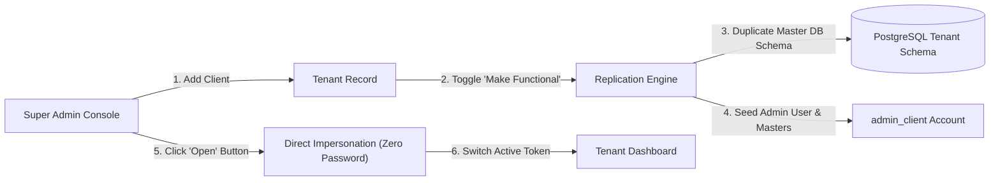

# 🏢 Multi-Tenant Client Provisioning

> Linked Entities: [[00_EduCore_Master_Index]], [[11_PostgreSQL_Cluster_Architecture]], [[10_Field_Level_RBAC_Permissions]]

## 1. Overview
The Super Admin manages collegiate clients (e.g. BFGI, Sanawar, GNDEC, Akal Academy) from a unified master console. Each client is provisioned with high isolation.

## 2. Technical Specifications
- **Client Metadata**:
  - `client_id`: Unique identifier formatted as `CL_[SHORT_CODE]` (e.g., `CL_BFGI`).
  - `subdomain`: Canonical hostname (e.g., `bfgi.gurudotcom`). Subdomain DNS is managed externally and mapped in ERP.
  - `entity_type`: `college` | `school` | `department`.
  - `db_name`: Isolated database/schema identifier `db_[short_code]`.
- **"Make Functional" / "Go in Production"**:
  - When marked functional, the system provisions a dedicated tenant schema in [[11_PostgreSQL_Cluster_Architecture]], replicates the master schema, and seeds standard tables (`master_departments`, `master_degrees`, etc.).
- **One-Click Direct Impersonation ("Open" Button)**:
  - Super Admin clicks "Open" next to any client.
  - Generates an impersonation session token (`POST /api/tenants/:id/impersonate`) allowing instant login as the institutional campus admin without re-entering credentials.\n