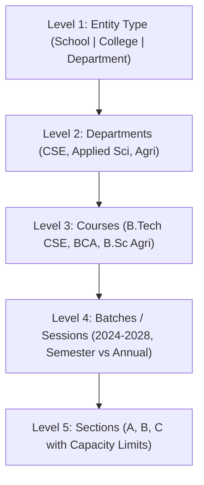

# 🌲 5-Level Academic Topology

> Linked Entities: [[00_EduCore_Master_Index]], [[03_Curriculum_and_Subject_Matrix]], [[06_Student_Progression_Lifecycle]]

## 1. The 5 Hierarchy Levels
Karanvir Sir specified a strict 5-tier collegiate hierarchy:

### Level 1: Entity Type
- Categorizes institutions into `School`, `College`, or `Department`.
- If a school does not have separate departments, the department defaults to the school's title (e.g., *Department of Humanities* within *School of Humanities*).

### Level 2: Departments
- Departments group related academic disciplines and faculties.
- Courses are mapped to departments for filtering, faculty allocation, and HOD administration.

### Level 3: Courses
- Degree programs (e.g., `B.Tech CSE`, `BCA`, `MBA`). Each has duration, total terms, statutory body (AICTE/UGC), and credit standards.

### Level 4: Batches / Sessions
- Full session duration (e.g., 2024-2028 for 4-year degree; 2024-2027 for 3-year degree).
- **Academic System**:
  - `semester` (e.g., 8 terms, 6 terms)
  - `annual` (e.g., 4 yearly terms, 1 term/year)
- **Active Terms Selection**:
  - Checkbox matrix of which terms are currently active during the current session (e.g. Terms 1, 3, 5, 7 in Autumn; Terms 2, 4, 6, 8 in Spring).

### Level 5: Sections & Non-Destructive Transfers
- Sections `A`, `B`, `C` with max capacity (e.g. 60 students).
- **Non-destructive Section Transfer**:
  - Endpoint: `POST /api/academics/sections/transfer`.
  - Shifts student between sections while preserving their cumulative attendance, marks, and [[09_Dynamic_Payment_Gateways_Live_Test|Fee Ledgers]].\n