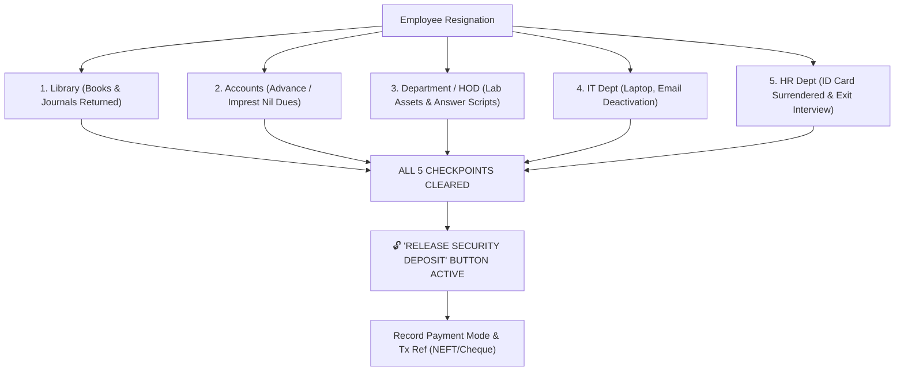

# 🚪 Online 5-Point Exit NOC System

> Linked Entities: [[07_HRMS_Payroll_and_Security_Deductions]], [[10_Field_Level_RBAC_Permissions]]

## 1. Departmental Clearance Checkpoints
When an employee resigns or completes their contract, EduCore initiates the 5-point No Objection Certificate (NOC) protocol:

## 2. Security Refund Gatekeeper
- The "Release Security Deposit" refund button remains strictly **DISABLED** until all 5 department checkpoints are verified and signed off.
- Releasing the refund updates the security deduction status to `refunded`, records the disbursement mode (NEFT/Cheque) and transaction reference, and creates an immutable cryptographic audit record.\n